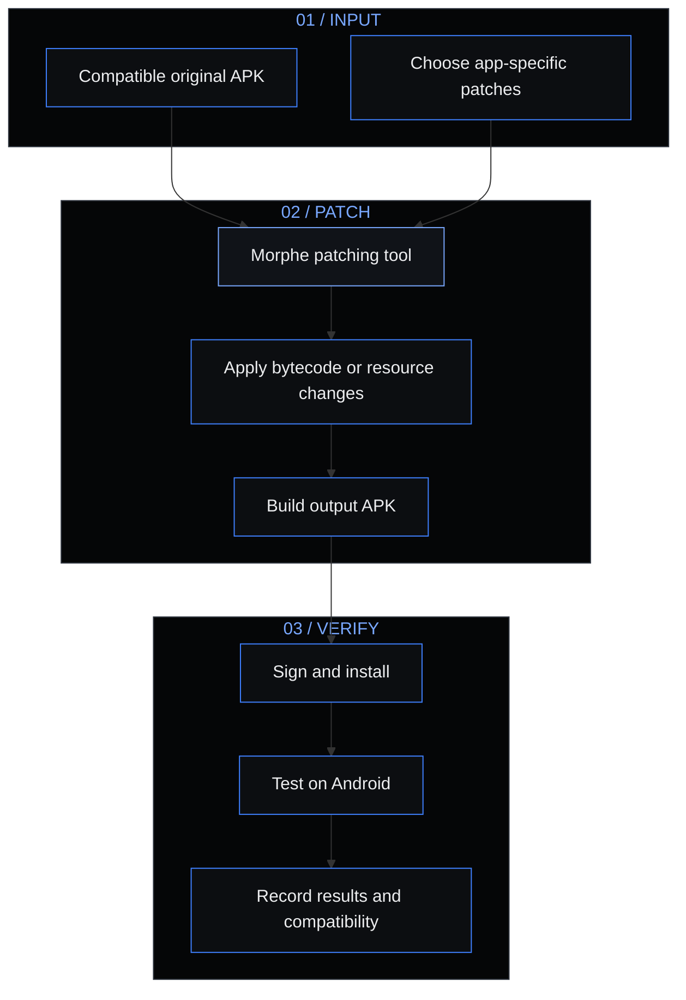

<div align="center">

<sub>XiONDiGiTaL / ANDROID PATCH LAB</sub>

# MØRPHE PATCHES

### Your apps. A different experience.

Independent patch projects for Morphe — appearance, usability, and app-level experiments.

[XiONDiGiTaL](https://xiondigital.net) · [Morphe](https://morphe.software) · [Project roadmap](#03--project-roadmap) · [Official documentation](https://github.com/MorpheApp/morphe-documentation)

</div>

---

> EARLY DEVELOPMENT — This is a growing, multi-app patch lab. Tandem is the first research target, not the limit of the project. No working patches or installable releases are available yet.

## 01 / The lab

MorphePatches is XiØN’s workspace for exploring, building, and maintaining custom Android patches for Morphe. Each app will have its own patch group, research notes, compatibility information, and testing status.

The direction is simple:

- Appearance — themes, dark mode, colors, and interface refinements.
- Usability — changes that make everyday interactions more comfortable.
- Fewer interruptions — investigate ad-related behavior and unnecessary UI.
- Local feature research — identify what can actually be changed on-device.
- Honest releases — publish supported versions and known limitations, not speculative compatibility claims.

Visual direction is inspired by xiondigital.net: near-black surfaces, electric-blue accents, editorial headings, and restrained technical details. GitHub controls the surrounding README typography and page background; the diagram below carries the custom palette.

## 02 / How Morphe works

Morphe is an Android application-patching ecosystem. Its patcher supports modular changes to Dalvik bytecode, APK resources, and other files inside an APK. A custom patch describes a modification to an existing app rather than rebuilding that app from its original source.



Conceptual workflow only: this repository does not yet provide a patch bundle or build system. APK formats, signing, and installation details depend on the selected tool and release.

| Component | Purpose |
| :--- | :--- |
| Original app | Supplies the code and resources being modified |
| Patch definitions | Identify targets and describe intended changes |
| Morphe patching tool | Applies selected patches to a compatible app |
| Device testing | Establishes whether the result actually works |
| Compatibility notes | Record supported versions, limitations, and regressions |

A local patch cannot create information or permissions that a server does not provide. Making a control visible is not proof that its underlying feature works.

Explore upstream: [Morphe Patcher](https://github.com/MorpheApp/morphe-patcher) · [Custom-patches template](https://github.com/MorpheApp/morphe-patches-template) · [Documentation](https://github.com/MorpheApp/morphe-documentation)

## 03 / Project roadmap

| Project | Focus | Stage | Verified versions |
| :--- | :--- | :--- | :--- |
| Tandem | Appearance, ad-related behavior, local feature research | First attempt / planned investigation | None |
| Future app projects | Added as research and implementation begin | Open roadmap | None |
| Shared utilities | Reusable helpers where appropriate | Planned | Not applicable |

### First attempt / Tandem

Tandem is the starting point for learning the patching workflow and establishing a repeatable process for future app projects.

| Candidate | Research goal | Status |
| :--- | :--- | :--- |
| Dark mode | Find an existing dark theme or investigate resource changes | Planned — APK not inspected |
| Ad removal | Locate ad-loading paths and associated interface elements | Planned — APK not inspected |
| Locally controlled Pro features | Determine whether any requested controls work independently of server entitlements | Unverified research target |
| Profile visitors | Determine whether identities reach the client or are withheld server-side | Feasibility unknown |

These are requested investigation targets, not implemented patches or promises of paid-feature access. No Tandem version has been verified from the supplied bundle or tested with patches.

### Progress checklist

- [x] Create MorphePatches.
- [x] Establish a multi-app project identity and README.
- [ ] Retrieve and inspect the first target bundle.
- [ ] Integrate an appropriate Morphe build template and preserve upstream notices.
- [ ] Verify package details and identify stable patch targets.
- [ ] Implement and test the first candidate patch.
- [ ] Document compatibility and known issues.
- [ ] Publish the first verified patch bundle.
- [ ] Expand to additional apps as projects begin.

## 04 / Organized by app

The intended source layout keeps app-specific work separate from reusable utilities:

```text
patches/src/main/kotlin/net/xiondigital/patches/
├── tandem/                 # First target
│   ├── appearance/
│   ├── ads/
│   └── features/
├── <future-app>/           # Added when a new project begins
└── shared/                 # Common helpers, when needed
```

This is a proposed layout, not a list of files already committed. The repository currently contains its README only. Build configuration, source folders, and app-specific documentation will be added as development proceeds.

Each future app project should document its package name, supported versions, available patches, testing results, and known limitations.

## 05 / Status means something

| Label | Meaning |
| :--- | :--- |
| Planned | A proposed change; implementation has not started |
| Investigating | App inspection or feasibility research is underway |
| Experimental | Code exists but is not sufficiently validated |
| Tested | A patch has been verified against a named app version and test setup |
| Released | A versioned patch bundle and compatibility notes are published |
| Blocked | A dependency, server restriction, or technical issue prevents progress |

A patch will not be labeled tested merely because it compiles or makes a button appear.

## 06 / Installation and issue reports

There is nothing to install from this repository yet. Release instructions and a Morphe source link will be added only after a valid bundle is published and verified.

For future bug reports, include:

1. App name, package name, and exact version.
2. Android version and device model.
3. Morphe tool version and selected patches.
4. Reproduction steps, expected behavior, and sanitized logs.

Do not post account tokens, signing keys, private conversations, visitor identities, or proprietary APKs in issues. Experimental modifications may fail or affect normal app behavior; keep important data backed up before testing.

## 07 / Credits and boundaries

Maintained by [XiØN / XiONDiGiTaL](https://github.com/XiONDiGiTaL) · [xiondigital.net](https://xiondigital.net)

MorphePatches is an independent project, not an official Morphe source. It is not affiliated with or endorsed by Morphe, Tandem, Tripod Technology GmbH, or developers of future target apps. Third-party names identify tools and compatibility targets only.

This repository is intended for patch source, documentation, and original project assets—not redistributed proprietary app packages. No repository-wide software license has been selected yet. When upstream code is incorporated, its applicable licenses and notices must be preserved.

---

<div align="center">

<sub>XiONDiGiTaL / BUILD · TEST · REFINE</sub>

One lab. Multiple apps. A patch at a time.

</div>
