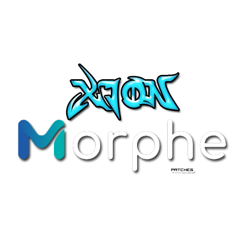

<!-- docs/ holds the GitHub Pages site: a dark editorial page in the same design
     system as xiondigital.net (assets/css/xion.css), with the patch collection as
     its only subject. Edit docs/index.html and docs/style.css; the logo lives at
     docs/assets/xion-morphe-patches.png and is used here and in the site header.

     Styling based on xiondigital.net (assets/css/xion.css):
     Dark editorial palette: bg #050607, panel #0c0e11 / #101318,
     ink #ecedef, body #bdc3cc, muted #8b9099,
     accent blue #3f80ff, blue-hi #79a8ff.
     Type on the site: Sora (display/body), Instrument Serif (italic accents),
     JetBrains Mono (eyebrow/labels). GitHub READMEs cannot load external
     fonts or site CSS, so this translates those cues into GitHub-safe
     elements: centred header, mono eyebrow, italic tagline, and blue badges. -->

<div align="center">

`MORPHE PATCHES — XIONDIGITAL`



*Independent Android patches and adaptations for [Morphe](https://morphe.software).*

[](https://morphe.software)
[](https://github.com/XiONDiGiTaL/MorphePatches/releases/tag/v1.0.0)
[](https://xiondigital.net/MorphePatches/)

<a href="#patches">01 / Patches</a> &nbsp; / &nbsp;
<a href="#releases">02 / Releases</a> &nbsp; / &nbsp;
<a href="#requests-and-issues">03 / Requests</a> &nbsp; / &nbsp;
<a href="https://xiondigital.net/MorphePatches/">Site ↗</a>

</div>

<br />

<table>
<tr>
<td width="65%" valign="top">

### What ships here

Four working patches for **Tandem: Language exchange** 6.38.0, written against Morphe's patch API and
shipped as a prebuilt bundle. Each one is a real change to Tandem's own dex, documented down to the
method it anchors on and the exact code it injects.

Version `v1.0.0` is tagged with the bundle attached, so the Morphe source link resolves and lists all
four patches for `net.tandem` 6.38.0.

</td>
<td width="35%" valign="top">

### Release status

**v1.0.0** — 2026-11-01

4 patches · `net.tandem` 6.38.0 · APK + APKM

Patch applies to the stock APK; not yet run on a device

[Downloads ↗](https://github.com/XiONDiGiTaL/MorphePatches/releases/latest)

</td>
</tr>
</table>

<br />

<a id="patches"></a>

## 01 / Morphe Patches

| App | Package | Patches |
| --- | --- | --- |
| [Tandem](Tandem/) | `net.tandem` | [Bypass PairIP checks](Tandem/README.md#bypass-pairip-checks) · [Force dark mode](Tandem/README.md#force-dark-mode) · [Remove ads](Tandem/README.md#remove-ads) · [Disable Adjust tracking](Tandem/README.md#disable-adjust-tracking) — 6.38.0 only |

Two copies of the same bundle — take either:

| Where | File | Size | SHA-256 |
| :--- | :--- | ---: | :--- |
| [Release `v1.0.0`](https://github.com/XiONDiGiTaL/MorphePatches/releases/tag/v1.0.0) | `patches-1.0.0.mpp` | 54,103 B | `aa402bfed77657cdc4ee15d30908ddc5c6ac04a4c8e589b74247a7df6a107cd3` |
| This repository | [`Tandem/patches.mpp`](Tandem/patches.mpp) | 54,178 B | `f12f1b3df3dbd3b18c3cf98cd8b667eb06d14492cb71e3f1df66389bc1c4dd0d` |

Both contain the same four patches and declare the same `Patcher-Version: 2.1.0`; the byte counts
differ only because CI rebuilds the zip when it tags a release. Import either file in Morphe Manager,
or patch your stock Tandem 6.38.0 file with it directly.

Supported: Tandem `6.38.0` (versionCode 11568), APKM bundle or single APK, minSdk 32. Any other
version is refused by the bundle instead of being patched blindly. Fingerprint matches and dex
assembly are verified against the stock APK; screen behaviour is not device-tested yet — the full
status is in [Tandem/README.md](Tandem/README.md#testing-status).

### Generated patch list

<!-- PATCHES_START EXPANDED -->
> **[v1.0.0](https://github.com/XiONDiGiTaL/MorphePatches/releases/tag/v1.0.0)**&nbsp;&nbsp;•&nbsp;&nbsp;`main`&nbsp;&nbsp;•&nbsp;&nbsp;4 patches total
<details open>
<summary>📦 Tandem: Language exchange&nbsp;&nbsp;•&nbsp;&nbsp;4 patches</summary>
<br>

**Package name:** `net.tandem`

**🎯 Supported versions:**

| 6.38.0 |
| :---: |

| 💊&nbsp;Patch | 📜&nbsp;Description | ⚙️&nbsp;Options |
|----------|----------------|-----------|
| [Bypass PairIP checks](#bypass-pairip-checks) | Skips PairIP's APK signature and Play licence checks, which otherwise stop a re-signed build from starting. Required for any patched Tandem build to run. |  |
| [Disable Adjust tracking](#disable-adjust-tracking) | Stops the bundled Adjust attribution SDK from initialising, so no install, session or event attribution is sent. |  |
| [Force dark mode](#force-dark-mode) | Turns on Tandem's own dark theme, regardless of the system dark-mode setting. |  |
| [Remove ads](#remove-ads) | Removes Tandem's community ad slot and blocks the bundled AppLovin MAX and Meta Audience Network SDKs from requesting ads. |  |

</details>

<!-- PATCHES_END -->

### How to use these patches

Add this repository as a Morphe source once and the patches show up inside the app, at the version in
the release table below:

```
https://morphe.software/add-source?github=XiONDiGiTaL/MorphePatches
```

Or import a file directly: download either bundle above, open it in Morphe Manager, select your Tandem
6.38.0 APK or APKM, keep **Bypass PairIP checks** enabled, and patch. Nothing needs to be built
locally — the `.mpp` in this repo is the finished artifact.

<a href="https://morphe.software/add-source?github=XiONDiGiTaL/MorphePatches">
  
</a>

Build the bundle locally with `./gradlew :patches:buildAndroid` — the
`.mpp` file is created at `patches/build/libs/patches-*.mpp`.

<br />

<a id="releases"></a>

## 02 / Releases

| Release | Date | Bundle | Contents |
| :--- | :--- | :--- | :--- |
| [`v1.0.0`](https://github.com/XiONDiGiTaL/MorphePatches/releases/tag/v1.0.0) | 2026-11-01 | [`patches-1.0.0.mpp`](https://github.com/XiONDiGiTaL/MorphePatches/releases/download/v1.0.0/patches-1.0.0.mpp) | All four Tandem 6.38.0 patches, first published version |

Releases are automated. Every push to `main` runs semantic-release, which tags the next version,
attaches the freshly built `.mpp`, regenerates `patches-list.json` and `patches-bundle.json`, and
rewrites the patch table above. `patches-list.json` is the file the Morphe add-source link reads, so a
tagged release is what makes these patches appear in the app.

Only patch bundles are distributed here. Original and prepatched proprietary application packages are not.

<details>
<summary>Patch status guide</summary>

| Status | Meaning |
| :--- | :--- |
| Experimental | Applies cleanly to the stock 6.38.0 APK; not yet confirmed on a device |
| Tested | Confirmed on a device, with the app version and setup recorded |
| Released | Included in a published bundle |

All four Tandem patches are **Experimental** in `v1.0.0`.

</details>

<br />

<a id="requests-and-issues"></a>

## 03 / Requests and issues

[Suggest a patch or report an issue ↗](https://github.com/XiONDiGiTaL/MorphePatches/issues)

When reporting a bug, include the Tandem version, the bundle version (`v1.0.0`), which patches were selected, your Android version, and reproduction steps. Remove personal information and credentials from logs.

<br />

## Frequently Asked Questions

#### How do I use this?

Add `XiONDiGiTaL/MorphePatches` as a source in Morphe Manager and it lists all four patches, or import
[`Tandem/patches.mpp`](Tandem/patches.mpp) directly. Then patch a stock Tandem 6.38.0 file, keeping
**Bypass PairIP checks** enabled — a re-signed build will not start without it.

#### What APK version should I use?

Tandem **6.38.0** (versionCode 11568), APKM bundle or single APK. The bundle declares only that
version, so Morphe refuses anything else. No other app is covered yet.

#### Are the patches tested?

They build, load and apply to the real 6.38.0 dex files, and every fingerprint anchor was verified
against that APK. None of it has been run on a device yet, which is why each patch is listed as
experimental.

#### Can you make a patch for another app?

Suggest it through Issues. Requests do not guarantee implementation or compatibility.

<br />

## 04 / Notice

An independent project by XiONDiGiTaL, not affiliated with, endorsed by, or sponsored by any third-party entity or project referenced here.

Original patches and adaptations are offered freely. Third-party applications, names, trademarks, assets, and other works belong to their respective owners. References identify compatibility targets or provide attribution; no ownership or endorsement is implied.

This project is intended to share independent modifications, not redistribute proprietary works or misrepresent authorship. Incorporated third-party work must retain its applicable licenses, notices, and credits. No repository-wide software license has been selected yet.

[Morphe ↗](https://morphe.software) &nbsp; / &nbsp; [Upstream patches ↗](https://github.com/MorpheApp/morphe-patches) &nbsp; / &nbsp; [Patch template ↗](https://github.com/MorpheApp/morphe-patches-template)

---

<div align="center">

---

<a href="https://xiondigital.net/MorphePatches/">XiØN · Morphe Patches ↗</a>

<sub>Independent patch collection — <a href="https://xiondigital.net">XiONDiGiTaL</a></sub>

</div>
