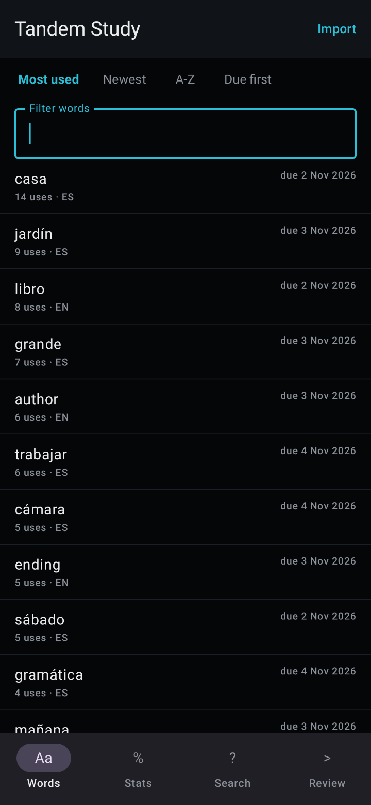
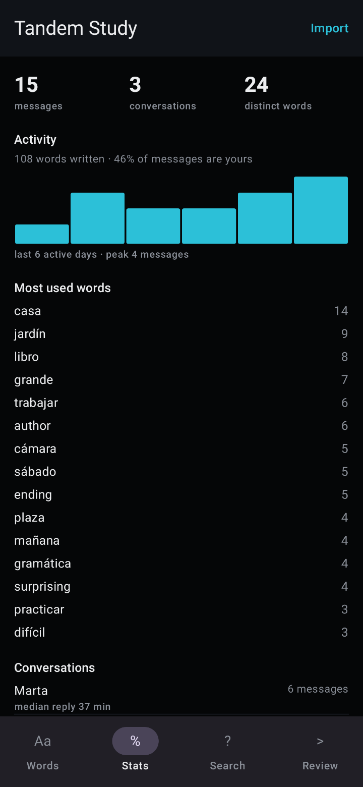
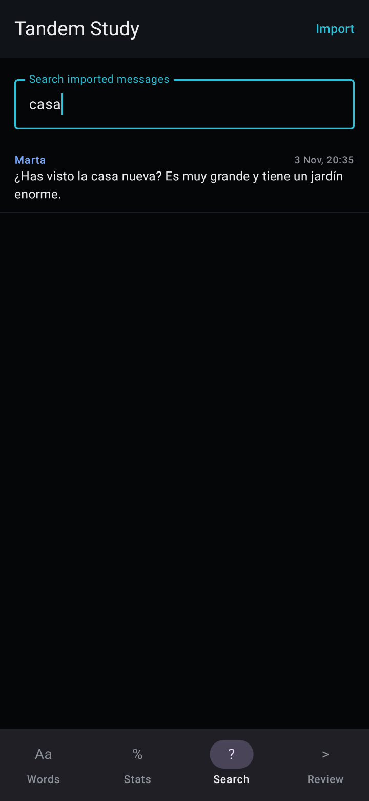
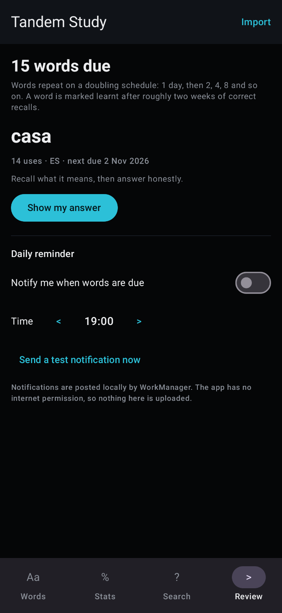

# Tandem

Patches for **Tandem: Language exchange** (`net.tandem`) by XiONDiGiTaL, built for
[Morphe](https://morphe.software).

The patches ship compiled in this folder: **[`patches.mpp`](patches.mpp)**, and as the `v1.0.1`
release asset. Import either file in Morphe Manager and patch a stock Tandem 6.38.0 APK or APKM —
nothing else is needed, and no build step is required to use it.

Adding `XiONDiGiTaL/MorphePatches` as a source
(`https://morphe.software/add-source?github=XiONDiGiTaL/MorphePatches`) lists the same four patches
inside Morphe.

The learning features a patch cannot add — vocabulary extraction, statistics, search and spaced
review — live in a separate offline app, [Tandem Study](../companion/README.md), described
[below](#companion-app-tandem-study).

| | |
| :--- | :--- |
| Release | [`v1.0.1`](https://github.com/XiONDiGiTaL/MorphePatches/releases/tag/v1.0.1) — `patches-1.0.1.mpp`, 54,129 bytes (2026-11-03, re-released) |
| Bundle | [`patches.mpp`](patches.mpp) — 54,129 bytes (the same build as the release asset) |
| SHA-256 | `dd9444f4690f1fe6e895393d9980aea4fa358d2c2e71acdc30d55f1f8140f50b` (both files) |
| Contents | 4 patches: Force dark mode, Bypass PairIP checks, Remove ads, Disable Adjust tracking |
| Target | Tandem **6.38.0** (versionCode **11568**), `net.tandem`, minSdk 32, targetSdk 37 |
| Patcher | Morphe patcher **2.1.0** (the bundle declares `Patcher-Version: 2.1.0`) |
| Format | APK and APKM (compatibility entries for both) |
| Status | **Experimental** — applies to the real 6.38.0 APKM and the patched dex is verified; not yet run on a device |

Verify the download before importing:

```bash
sha256sum patches.mpp
# dd9444f4690f1fe6e895393d9980aea4fa358d2c2e71acdc30d55f1f8140f50b
```

## Patches in the bundle

All four are enabled by default; each can be turned off individually in Morphe Manager.

| Patch | What it changes | Methods touched |
| :--- | :--- | :--- |
| [Force dark mode](#force-dark-mode) | Injects an app-level night-mode call at `TandemApp.onCreate()` | 1 (injected) |
| [Bypass PairIP checks](#bypass-pairip-checks) | Empties PairIP's signature and licence checks, and closes the licence screen it falls back to | 6 |
| [Remove ads](#remove-ads) | Empties Tandem's community-ad composable and the ad SDKs' load methods | 11 |
| [Disable Adjust tracking](#disable-adjust-tracking) | Empties `Adjust.initSdk(...)` | 1 |

Every patch is confined to methods that already exist in the APK: nothing is added to the manifest, no
permission changes, no service is redirected, and the only injected code is the single night-mode call
in the dark-mode patch.

---

### Force dark mode

**Effect.** Tandem ships a full dark theme — a `values-night` resource overlay plus a Compose theme
that respects `uiMode` — but the app has no appearance setting of its own, so the theme is reachable
only through the system-wide dark-mode switch. This patch turns Tandem's own dark theme on for Tandem
alone. Other apps and the system setting are untouched.

**Change.** One platform call is prepended to `net.tandem.TandemApp.onCreate()`:

```smali
const-string v0, "uimode"
invoke-virtual {p0, v0}, Landroid/content/Context;->getSystemService(Ljava/lang/String;)Ljava/lang/Object;
move-result-object v0
check-cast v0, Landroid/app/UiModeManager;
const/4 v1, 0x2                     # UiModeManager.MODE_NIGHT_YES
invoke-virtual {v0, v1}, Landroid/app/UiModeManager;->setApplicationNightMode(I)V
```

`Application.onCreate()` runs once per process, before the first activity resolves a theme or a
Compose palette, so every screen starts in Tandem's night configuration. `setApplicationNightMode`
exists from API 31 and this build is minSdk 32.

**Anchor.** `net.tandem.TandemApp;->onCreate()V` — inherited unchanged by the PairIP wrapper
(`com.pairip.application.Application` only overrides `attachBaseContext`), so it is neither
obfuscated nor displaced by the integrity patch.

**Not touched.** No theme, colour, activity, layout or resource is renamed or replaced, so user
images, media, icons, dialogs and system bars keep using Tandem's own night resources. Nothing is
force-inverted.

---

### Bypass PairIP checks

**Effect.** Lets a patched, re-signed build start — and stay started. 6.38.0 is protected with PairIP:
the manifest declares `com.pairip.application.Application`, whose `attachBaseContext` runs two gates
before Tandem initialises.

| Gate | What it does | Why a patched build trips it |
| :--- | :--- | :--- |
| `SignatureCheck.verifyIntegrity(context)` | Base64 SHA-256 of the APK signing certificate, compared to expected values | Any re-signed APK mismatches and throws `SignatureTamperedException("Apk signature is invalid.")` before the first activity |
| `LicenseClient.checkLicense(context)` | Binds Play's licensing service | A sideloaded build cannot satisfy the licence response |

The licence flow is not only a check. Behind it there is a screen and a kill switch, and reaching
them at launch is what a Play prompt and an app that closes by itself look like:

| Component | What it does |
| :--- | :--- |
| `LicenseClient.startPaywallActivity(PendingIntent)` | Fires the store listing Play's licensing response carries, then calls `closeApp()`: the user is thrown into Google Play and out of Tandem |
| `LicenseClient.startErrorDialogActivity()` | The same for a soft failure |
| `LicenseClient.scheduleAppShutdown()` | Arms a 30-second delayed exit, so a run that looks healthy first still terminates |
| `LicenseActivity.onStart()` | Renders whichever of the two its intent asks for |

**Change.** Five bodies become a single `return-void`, and the licence activity closes itself instead
of drawing its dialog:

```smali
.method private startPaywallActivity(Landroid/app/PendingIntent;)V
    return-void
.end method

.method public onStart()V              # LicenseActivity
    invoke-virtual {p0}, Landroid/app/Activity;->finish()V
    return-void
.end method
```

All five are `void` methods — no state other code reads and no caller expects a result — so emptying
them cannot change how Tandem starts or talks to its servers. The activity is finished rather than
emptied because an empty `onStart()` would leave an invisible window that never closes.

**Anchors** (stock 6.38.0 `base.apk`, `classes2.dex`):

```smali
Lcom/pairip/SignatureCheck;->verifyIntegrity(Landroid/content/Context;)V              # public static
Lcom/pairip/licensecheck/LicenseClient;->checkLicense(Landroid/content/Context;)V     # public static
Lcom/pairip/licensecheck/LicenseClient;->startPaywallActivity(Landroid/app/PendingIntent;)V  # private
Lcom/pairip/licensecheck/LicenseClient;->startErrorDialogActivity()V                  # private
Lcom/pairip/licensecheck/LicenseClient;->scheduleAppShutdown()V                       # private
Lcom/pairip/licensecheck/LicenseActivity;->onStart()V                                 # public
```

**Not touched.** PairIP's method-level protection (`VMRunner`, `StartupLauncher`) stays active, so the
classes it decrypts at runtime still load. That runtime is why the licence activity is closed rather
than only skipped: code PairIP decrypts at startup cannot be reached by a dex fingerprint, but it can
only put the prompt in front of the user through that one activity.

This patch is on by default because nothing else can run without it: the re-sign every patcher
performs is exactly what the signature check rejects.

---

### Remove ads

**Effect.** Removes Tandem's community ad slot and stops both bundled ad SDKs from requesting ads, so
no app-open, banner, interstitial or native ad is delivered or rendered.

**Change.** Three paths, eleven methods, each reduced to `return-void`:

| Path | Anchors in 6.38.0 | Result |
| :--- | :--- | :--- |
| Tandem's community ad slot | `Ljhp;->a(Lex4;Lf79;Lpw4;Leh;Lbg5;I)V` — the one composable consuming `CommunityAdConfig(adUnitId, adSize)` for unit `ca-app-pub-4507927355231659/3667237836` | The slot emits nothing, which is the `config == null` branch the screen already handles; no ad view is created |
| AppLovin MAX | `MaxAppOpenAd.loadAd()`, `MaxInterstitialAd.loadAd()`, `MaxAdView.loadAd()`, `MaxAdView.startAutoRefresh()` | No request is made; `isReady()` stays false; banner refresh never arms |
| Meta Audience Network | `InterstitialAd.loadAd()` and `loadAd(InterstitialLoadAdConfig)`, `AdView.loadAd()` and `loadAd(AdViewLoadConfig)`, `NativeAdBase.loadAd()` and `loadAd(NativeLoadAdConfig)` | Same, for both call styles |

Both the no-argument and the `…LoadAdConfig` overloads are replaced because either call style reaches
the SDK.

**Anchors** (stock 6.38.0 `base.apk`, `classes.dex` / `classes4.dex`):

```smali
Ljhp;->a(Lex4;Lf79;Lpw4;Leh;Lbg5;I)V                                      # public static
Lcom/applovin/mediation/ads/MaxAppOpenAd;->loadAd()V                      # public
Lcom/applovin/mediation/ads/MaxInterstitialAd;->loadAd()V                 # public
Lcom/applovin/mediation/ads/MaxAdView;->loadAd()V                         # public
Lcom/applovin/mediation/ads/MaxAdView;->startAutoRefresh()V               # public
Lcom/facebook/ads/InterstitialAd;->loadAd()V                              # public
Lcom/facebook/ads/InterstitialAd;->loadAd(Lcom/facebook/ads/InterstitialAd$InterstitialLoadAdConfig;)V
Lcom/facebook/ads/AdView;->loadAd()V                                      # public
Lcom/facebook/ads/AdView;->loadAd(Lcom/facebook/ads/AdView$AdViewLoadConfig;)V
Lcom/facebook/ads/NativeAdBase;->loadAd()V                                # public
Lcom/facebook/ads/NativeAdBase;->loadAd(Lcom/facebook/ads/NativeAdBase$NativeLoadAdConfig;)V
```

R8 relocated Tandem's own classes into the default package (jadx shows them under `defpackage/`),
which is why the community composable's descriptor is the one-letter `Ljhp;`; the SDK classes keep
their package names because their consumer rules preserve the public API surface.

**Not touched.** Rewarded formats (`MaxRewardedAd`, `RewardedVideoAd`, `RewardedInterstitialAd`) stay:
they are requested only when the user chooses to earn something, so blocking them would remove a
feature rather than an annoyance. SDK initialisation also stays — nothing loads without one of the
replaced methods, and gutting `init` would break the mediation callbacks Tandem registers.

Ad delivery is decided on-device — the SDK decides what to request and the slot decides what to draw —
so replacing the load methods removes the ads without touching anything the server sends.

---

### Disable Adjust tracking

**Effect.** Stops Tandem's bundled Adjust attribution SDK (246 classes) from initialising, so no
install, session, event or deep-link attribution is sent.

**Change.** `Adjust.initSdk(AdjustConfig)` becomes `return-void`. Tandem calls it once with app token
`w9jqbcact05c`, then calls `Adjust.enable()` and `Adjust.onResume()`.

**Anchor** (stock 6.38.0 `base.apk`, `classes2.dex`):

```smali
Lcom/adjust/sdk/Adjust;->initSdk(Lcom/adjust/sdk/AdjustConfig;)V # public static
```

**Not touched.** The two follow-up calls are left in place deliberately: `AdjustInstance.enable()`
guards itself with `checkActivityHandler(...)`, which logs and returns when no session exists, so they
are already no-ops. Tandem's deep-link handler is registered separately on the application object and
is unaffected. Tandem's Firebase Analytics usage is a different SDK and is not touched by this patch.

---

## Install

1. Use Tandem **6.38.0** (versionCode 11568) — APKM bundle or single APK.
2. In Morphe Manager, either import [`patches.mpp`](patches.mpp) (or the [`v1.0.1`](https://github.com/XiONDiGiTaL/MorphePatches/releases/tag/v1.0.1) asset), or add `XiONDiGiTaL/MorphePatches` as a patch source and let it list the four patches.
3. Select your Tandem file. Keep **Bypass PairIP checks** enabled (a re-signed build will not start
   without it); enable the other three as wanted.
4. Patch, then install. The result is signed differently from the store build, so uninstall the stock
   app first and have your login details ready.

## Compatibility

Only 6.38.0 is declared, so Morphe refuses the bundle on any other version instead of silently
patching it. Adding a version is a claim that the fingerprints and the injected code were verified
against that exact build.

Reference file: APKMirror universal bundle
`sha256 17539cc675654353e5971a8fd2bea6384876c71f63b387f8d95ef6cf7502e3ca` (`base.apk`
`sha256 940797a624210ba555fc0e67e9b7ce9456c4dd811450d4e973ac716ee721942b`).

## Testing status

| Check | Result |
| :--- | :--- |
| Kotlin compiles against patcher 2.1.0 | Pass |
| `:patches:buildAndroid` produces the bundle | Pass |
| Bundle loads via Morphe's `loadPatchesFromJar` | Pass |
| Metadata identifies `net.tandem`, 6.38.0, minSdk 32 | Pass |
| Bundle applies to the APKMirror 6.38.0 APKM (fingerprint match + dex assembly) | Pass — all four patches complete; 11 classes rewritten |
| Every patch applies in CI on each push | [`patch-regression.yml`](../.github/workflows/patch-regression.yml), against the pinned reference APKM |
| Injected night-mode call present in the patched dex | Pass — decompiles to `((UiModeManager) getSystemService("uimode")).setApplicationNightMode(2)` as the first statement of `onCreate()` |
| All 14 anchor methods for the other three patches present in the stock dex | Pass — ad, PairIP and Adjust anchors match in `classes.dex`, `classes2.dex`, `classes4.dex` of the reference `base.apk` |
| Patched dex contains the intended changes | Pass — decompiled: `verifyIntegrity`, `checkLicense`, `startPaywallActivity`, `startErrorDialogActivity`, `scheduleAppShutdown`, `initSdk`, `Ljhp;->a` and all ten ad load methods are a single `return-void`; `LicenseActivity.onStart()` is `finish()`; `onCreate()` starts with `setApplicationNightMode(2)` |
| Unsupported versions rejected | Pass by construction — only 6.38.0 is declared |
| Dark mode on screens, dialogs, navigation | **Not tested** — no device or emulator available |
| Ad slot absence, login, messaging | **Not tested** — same reason |

The last two rows decide whether this bundle is usable; until they are confirmed on a device it stays
experimental.

## Known limitations

- **Not device-tested.** Everything above is checks against the APK's own dex and resources, not
  screen behaviour.
- **No in-app toggle.** Each patch is on or off at patch time; a runtime switch would need a settings
  destination and a persisted preference inside Tandem's settings architecture.
- **Only night-aware UI changes.** Screens, WebViews or creatives that ignore `uiMode` look the same as
  they do with the system dark mode on.
- **Rewarded ads stay** — by design, as described above.
- **PairIP risk remains.** The signature check, the licence check and the licence UI are gone, but a
  future server-side integrity signal could still refuse a patched client.
- **Signing is still not Play's.** The patched build is signed with the patcher's key, so Play's own
  "installed by Play" checks and store updates will not recognise it; that is inherent to patching,
  not something a patch can restore.

## Warnings

- Do not apply to any Tandem build other than 6.38.0, and do not force a version mismatch.
- Do not combine with another Tandem patch that injects at `Application.onCreate()`.
- Store updates will not install over the patched, differently-signed build.

## Building the bundle

```bash
# JDK 21, from the repository root
./gradlew :patches:buildAndroid
# -> patches/build/libs/patches-*.mpp   (copy over Tandem/patches.mpp when it changes)
```

Patch sources live in `patches/src/main/kotlin/app/xiondigital/patches/tandem/` — one package per
patch plus `shared/Constants.kt` for the compatibility declarations.

The Morphe Gradle plugin is published only to GitHub Packages, which needs credentials even for public
packages: export `GITHUB_ACTOR` and a `GITHUB_TOKEN` with `read:packages`, or set `gpr.user` /
`gpr.key` in `~/.gradle/gradle.properties`.

## Regression check

[`patch-regression.yml`](../.github/workflows/patch-regression.yml) builds the bundle, applies every
patch it advertises to the reference 6.38.0 APKM with Morphe's own patcher, and fails unless the run
reports all of them applied. Morphe aborts on the first fingerprint that stops matching, so this is the
check that `v1.0.0` and the first `v1.0.1` never ran. The patcher release is pinned by tag and SHA-256
in the workflow.

The reference APK is proprietary and is not committed. It is configured for this repository already:

1. The APKM lives as a release asset in a **private** fixture repository, so it is never redistributed
   with the patches.
2. The repository variable `TANDEM_APKM_URL` points at that asset, and the secret `TANDEM_APKM_TOKEN`
   holds a token that can read it. Neither value belongs in the workflow file.
3. Its SHA-256 has to match [`.github/fixtures/net.tandem-6.38.0.apkm.sha256`](../.github/fixtures/net.tandem-6.38.0.apkm.sha256);
   change that line only when the reference build itself changes. A different file fails the job with
   a configuration error instead of patching the wrong build.

Without the variable the job still builds the bundle and reports the apply step as skipped, which is
also what happens on pull requests from forks, where the token is not available.

## Changelog

### 1.0.1 — 2026-11-03

Re-release of 1.0.1 with the bundle that actually applies. The first 1.0.1 asset, like 1.0.0, aborted
at patch time, so it was withdrawn.

- `Bypass PairIP checks`, `Remove ads` and `Disable Adjust tracking` emptied bodies with
  `instructions.clear()`, which always throws `UnsupportedOperationException` on dexlib2's read-only
  instruction list. They now go through the implementation's own `removeInstruction`.
- The community-ad fingerprint declared `public static`, but Morphe compares `accessFlags` exactly and
  the method is `public static final`. It now matches with `isStatic`.
- The offline companion app, [Tandem Study](../companion/README.md), ships alongside the bundle.

### 1.0.0 — 2026-11-01 (retired)

The first published bundle. It contains the same patch-time defects fixed in 1.0.1, so patching with
it aborts before any change; use 1.0.1.

First tagged release: [`v1.0.0`](https://github.com/XiONDiGiTaL/MorphePatches/releases/tag/v1.0.0)
with `patches-1.0.0.mpp` attached, and `patches-list.json` published so the Morphe source link lists
all four patches.

- `Remove ads`: community-ad composable (`Ljhp;->a`) plus ten AppLovin MAX / Meta Audience Network load
  methods reduced to `return-void`; rewarded formats and SDK init left intact. Eleven anchors verified
  in the stock `base.apk`.
- `Bypass PairIP checks`: `SignatureCheck.verifyIntegrity` and `LicenseClient.checkLicense` reduced to
  `return-void`; anchors verified in `classes2.dex`.
- `Disable Adjust tracking`: `Adjust.initSdk(AdjustConfig)` reduced to `return-void`; anchor verified
  in `classes2.dex`.
- `Force dark mode`: `UiModeManager.setApplicationNightMode(2)` injected at `TandemApp.onCreate()`;
  verified against the real APK.

## Companion app: Tandem Study

The requested learning features — vocabulary extraction, conversation statistics, search over your
own history, spaced-repetition review and daily reminders — need a store, an algorithm and a screen,
which a dex patch cannot add. They ship as a separate offline app in
[`../companion`](../companion/README.md), built on the archive Tandem already gives you through
**Profile → Settings → Download my data**. No `INTERNET` permission, nothing uploaded, and Tandem
itself is untouched.

| Words | Statistics |
| :---: | :---: |
|  |  |
| **Search** | **Review and reminders** |
|  |  |

These are rendered from the app's own screens by `ScreenshotTest` (Robolectric with seeded data), not
mock-ups, and regenerated the same way.

## Back to the collection

[../README.md](../README.md)
